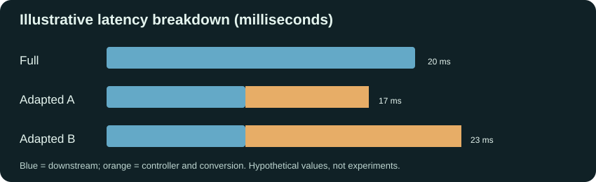

# Resource-Aware Adaptive Feature Representations for AI Inference

> **Status:** Research proposal and prototype design · **No measured results yet**  
> **Research question:** Can inference-time selection of feature width and numerical precision reduce *measured end-to-end* latency, feature memory and energy while preserving an acceptable quality floor?

[Concept](#the-intuition) · [Architecture](#system-architecture) · [Controller](#controller-algorithms) · [Interactive simulation](#interactive-controller-simulation) · [Experiments](#experiments-and-baselines) · [Roadmap](#implementation-roadmap)

## The intuition

Imagine a picture of a bird. Detecting **whether a bird is present** may need less detail than identifying the **exact species**. An AI system likewise may not always need the same number of feature values or the same precision for every supported workload. But careless simplification can damage predictions.

This project changes **internal numerical representations**, not necessarily the input images themselves. It proposes choosing *how many values* to keep (**dimensionality**) and *how many bits* to store per value (**quantization**) in response to resource and workload signals.

> We do **not** assume that smaller features automatically mean faster inference. We measure the costs.

## Essential terminology

| Term | Meaning | Consequence |
|---|---|---|
| Training | Fitting model parameters | Done before inference; different-width heads may require training |
| Inference | Running a trained model to predict | Runtime controller makes decisions here |
| Encoder / backbone | Network producing learned numerical features | Often dominates compute; initially kept fixed |
| Embedding / latent feature | Internal vector or tensor | The representation we adapt |
| Dimensionality | Number of coordinates (e.g., 1024D) | Controls representation width and potentially downstream work |
| FP32, FP16, INT8 | 32-bit float, 16-bit float, 8-bit integer storage | Precision and hardware support differ |
| Quantization | Mapping floating-point values to approximations at lower precision | Reduces storage, can introduce error |
| Downstream head | Classifier or predictor processing features | Must accept the selected width/dtype |
| Telemetry | Observable load, available memory, queue length, recent latency | Inputs to controller |
| Policy | Decision rule for selecting configurations | A central part of the research |
| Overhead | Monitoring, decision, projection, conversion and synchronization costs | Determines net benefit |

## Intermediate features

An encoder transforms an input into a representation that a downstream classifier processes:

~~~mermaid
flowchart LR
  A["Image / input"] --> B["Encoder"]
  B --> C["Intermediate feature vector"]
  C --> D["Compatible downstream classifier"]
  D --> E["Prediction"]
~~~

A *toy* feature vector might look like:

\[
F=[0.82,\ 0.14,\ -0.67,\ 0.93,\ 0.21,\ 0.56].
\]

Real vectors may have hundreds or thousands of entries. Each coordinate is learned; it should not be assumed to represent one human-interpretable attribute.

## Two adaptation techniques

### 1. Feature dimensionality reduction

Change the number of features:

~~~text
Full:    [■■■■■■■■■■■■■■■■]   1024D
Reduced: [■■■■■■■■        ]    512D
Compact: [■■■■            ]    256D
~~~

Options include:
- **PCA:** projection onto directions of greatest variance, learned from appropriate training data.
- **Learned projection:** a trained map from original to reduced dimensionality.
- **Nested features / width-aware models:** construct smaller, meaningful prefixes or subrepresentations.

**Critical constraint:** Simply dropping coordinates of an arbitrary pretrained representation can damage quality or cause tensor mismatches. Each width needs a compatible downstream head or carefully engineered width-adaptive network. The transformation itself can be costly.

### 2. Quantization

Change bits **per feature**, not the feature count:

~~~text
FP32: [■■■■■■■■■■■■■■■■■■■■■■■■■■■■■■■■] 32 bits
FP16: [■■■■■■■■■■■■■■■■                ] 16 bits
INT8: [■■■■■■■■                        ]  8 bits
~~~

INT8 needs suitable quantization parameters (such as scale and zero point) and compatible operators. Sometimes converting to and from INT8 costs more than it saves. FP16/INT8 arithmetic acceleration is hardware and backend dependent.

### Combined raw-storage example

| Mode | Dimensions | Precision | Raw bytes/vector | Reduction vs full |
|---|---:|---|---:|---:|
| Full | 1024 | FP32 | 4096 | 0% |
| Balanced | 512 | FP16 | 1024 | 75% |
| Compact | 256 | INT8 | 256 | 93.75% |

Formula:

\[
M_{\mathrm{raw}}=\frac{d\,b}{8}\ \mathrm{bytes}
\]

where \(d\) = feature dimensions and \(b\) = bits/feature.

**Important:** 93.75% is a *raw feature-vector storage reduction*, not measured total RAM or energy reduction. The width values here are illustrative: a standard pooled ResNet-18 embedding is normally 512D, so a real ResNet-18 experiment must use matching actual widths.

## System architecture

~~~mermaid
flowchart TD
    A["Input"] --> B["Fixed pretrained encoder"]
    B --> C["Intermediate features"]
    T["Telemetry: available memory, queue, utilization, recent latency"] --> D["Resource-aware controller"]
    D -->|"Supported width + precision"| E["Representation adapter"]
    C --> E
    E --> F["Compatible downstream head"]
    F --> G["Prediction"]
    G -. "Offline quality, latency and energy evaluation" .-> H["Policy profiling and calibration"]
    H -. "Update profiles between experiments" .-> D
    classDef focus fill:#dcf5ee,stroke:#12836b,color:#14564d
    class D,E focus
~~~

**Step-by-step:**
1. Run an input through the encoder.
2. Read inference-time observable workload/resource signals.
3. Select a **supported** width/precision pair.
4. Convert the intermediate representation and dispatch to the matching downstream head.
5. Measure prediction quality and complete operational costs.

### Signals, not oracles

| Signal | What it tells us | Caveat |
|---|---|---|
| Available system/device memory | Capacity pressure | May not reflect temporary allocations |
| CPU/GPU utilization | Contention level | High utilization does not itself imply one format is faster |
| Request rate, queue depth | Demand/queuing pressure | May be noisy |
| Recent inference latency | Observed runtime | Requires appropriate smoothing |
| Power telemetry | Energy measurement basis | Needs permission, timing alignment and calibrated instrumentation |

**Never use unseen future states or ground-truth test labels as controller inputs.**

## Controller algorithms

### A. Simple interpretable baseline

~~~python
def choose_configuration(memory_percent, cpu_load_percent):
    # Illustrative thresholds; must be calibrated, not assumed optimal
    if memory_percent < 35 or cpu_load_percent > 80:
        return "compact"
    if memory_percent > 70 and cpu_load_percent < 40:
        return "full"
    return "balanced"
~~~

This heuristic is useful as a comparison baseline. Production-like policies also need hysteresis, minimum dwell time, supported-action checks and fallback logic.

### B. Profile-driven constrained optimizer

For a runtime resource state \(s\) and a supported candidate \(c=(d,b)\), let:
- \(L(c,s)\): expected complete latency,
- \(E(c,s)\): expected measured energy,
- \(M(c,s)\): expected memory use,
- \(Q(c)\): validation-based task quality.

Choose among feasible supported configurations:

\[
c^*(s)=\arg\min_{c\in\mathcal C_{\mathrm{valid}}(s)}
\left[\alpha\widetilde{L}(c,s)+\beta\widetilde{E}(c,s)+\gamma\widetilde{M}(c,s)\right]
\]

subject to:

\[
Q(c)\ge Q_{\mathrm{full}}-\varepsilon
\]

Here \(\varepsilon\) is an agreed quality-loss tolerance. Costs need meaningful normalization before weighting. A low-resource state may make every action infeasible; this should be surfaced rather than blindly assuming the full model fits.

~~~python
def select_configuration(configs, resource_state, profiles, quality_floor):
    feasible = []
    for c in configs:
        if not profiles.supported(c, resource_state.device):
            continue
        if profiles.validation_quality(c) < quality_floor:
            continue
        latency = profiles.total_latency(c, resource_state)
        energy = profiles.total_energy(c, resource_state)
        memory = profiles.total_memory(c, resource_state)
        if memory > resource_state.memory_budget:
            continue
        cost = (0.5 * profiles.normalize_latency(latency)
              + 0.3 * profiles.normalize_energy(energy)
              + 0.2 * profiles.normalize_memory(memory))
        feasible.append((cost, c))
    return min(feasible, key=lambda x: x[0])[1] if feasible else None
~~~

This is an **algorithm sketch**, not a ready-to-run model: the profiles and compatible heads must first be implemented and validated.

### C. Advanced extension: contextual bandit

A contextual bandit could learn which action tends to work under specific observable conditions. This entails exploration, nonstationarity and quality/safety constraints, so it is an **optional** experiment, not essential to the initial feasibility gate.

## Interactive controller simulation

**[Open the interactive demo source](demo/controller.html)** — download/open the standalone HTML in a browser. When GitHub Pages is enabled, the hosted address can be:

**https://srivastavaprisha29-ops.github.io/Adaptive-Systems/demo/controller.html**

The demo includes:
- Available memory and processor workload sliders.
- Quality policy selection.
- Full / balanced / compact controller decisions.
- Raw feature-memory visualization.
- Controller/conversion overhead slider showing latency break-even.

> Simulation inputs and decision thresholds are **illustrative**. It is a teaching tool, not measured AI model behavior. GitHub does not execute JavaScript inside README Markdown.

## Measuring net benefit

\[
T_{\mathrm{total}} =
T_{\mathrm{preprocess}}+T_{\mathrm{encoder}}+
T_{\mathrm{telemetry}}+T_{\mathrm{controller}}+
T_{\mathrm{conversion}}+T_{\mathrm{downstream}}+T_{\mathrm{other}}
\]

Avoid double-counting nested timing intervals, and ensure each baseline uses a comparable measurement boundary.

*Hypothetical demonstration:* full downstream = 20 ms. Reduced downstream = 9 ms. If control + conversion take 8 ms, total is 17 ms (gain). If they take 14 ms, total is 23 ms (regression). **No experimental results are implied.**

For energy, record the appropriate integration of measured power over the defined boundary:

\[
E_{\mathrm{joules}}=\int_{t_0}^{t_1}P(t)\,dt
\]

Do **not** substitute elapsed time for energy measurements. State whether energy is device-only or entire-system, and how idle power was treated.

## Experiments and baselines

| Baseline / policy | Width | Precision | Adaptive? | Purpose |
|---|---|---|---|---|
| Full fixed | Full | Full | No | Reference quality and cost |
| Width-only fixed | Reduced | Full | No | Isolate dimension change |
| Quantization-only fixed | Full | Reduced | No | Isolate bit-width change |
| Combined fixed | Reduced | Reduced | No | Compare joint adaptation without controller |
| **Best feasible static** | Validation-selected | Validation-selected | No | Essential fair comparator |
| Threshold heuristic | Selected at runtime | Selected at runtime | Yes | Transparent adaptation baseline |
| Profile-driven optimizer | Selected at runtime | Selected at runtime | Yes | Research candidate |

Workloads: steady-state, burst, gradual load changes, abrupt memory pressure, rapid oscillation and low-benefit negative controls.

**Measure:** task accuracy/quality; median/p95 end-to-end latency; throughput; raw feature bytes vs allocated/peak memory; energy in joules per inference (where measurable); control/conversion cost; policy-switching frequency; budget violations; and uncertainty/confidence intervals over repeated trials.

**Ablations:** dimension only, quantization only, both combined, overhead included/excluded for attribution, rule-based vs cost-based controller, hysteresis on/off.

**A claim of controller superiority requires comparison to the best valid static representation, not just to an artificially expensive full baseline.**

## Suggested initial study

A *possible* starter setup is **CIFAR-10 + a pretrained ResNet-18 encoder + trained dimension-compatible classification heads** using Python and PyTorch.

1. Fix and profile the encoder.
2. Extract the actual feature tensor; a typical pooled ResNet-18 output has 512 dimensions.
3. Train/validate compatible heads for e.g. 512/256/128-dimensional representations.
4. Test only numeric precisions genuinely supported by the intended CPU/GPU backend.
5. Establish fixed-format cost curves **before** optimizing the controller.

Choose the task/model/device based on available data, hardware, energy instrumentation and a literature-backed research gap. This is a proposal, not an approved final stack.

## Implementation roadmap

| Phase | Deliverable | Go/no-go criterion |
|---|---|---|
| 0 — Scope | One task, one hardware target, quality tolerance, closest-work matrix | Novelty hypothesis is testable |
| 1 — Reference | Reproduced full-model metrics and measurement harness | Timings and quality stable |
| 2 — Formats | Multiple compatible feature widths and supported precisions | Correctness and quality verified |
| 3 — Profiling | Static quality/latency/memory/energy cost surface | At least one plausible net-benefit regime |
| 4 — Controller | Rule baseline, cost-aware policy, fallback, hysteresis | Decisions valid and stable |
| 5 — Evaluation | Held-out trials, baselines, ablations, statistics | Improvements are net, not hidden overhead |
| 6 — Paper | Reproducible artifact, literature comparison, limitations | Claims supported by evidence |

### Research task checklist

- [ ] Fix model checkpoint, dataset version, split and deployment device.
- [ ] Establish training/calibration/validation/test separation.
- [ ] Measure profiling and instrumentation overhead.
- [ ] Implement and validate dimension-adaptive features and matching heads.
- [ ] Verify FP16/INT8 actual runtime support before benchmarking them.
- [ ] Characterize static configurations and conversion break-even point.
- [ ] Implement heuristic and constrained optimization controllers.
- [ ] Run fluctuating-resource tests and quantify switching oscillations.
- [ ] Compare to the **best static feasible** baseline.
- [ ] Perform repeated trials, confidence intervals, full ablations.
- [ ] Audit research novelty against closest published methods.
- [ ] Release code, configurations, scripts and provenance before claiming reproducibility.

## Research contribution and limitations

PCA, quantization and resource-monitoring controllers already have established literature. **Simply combining them is not proof of publication-level novelty.** A defensible contribution needs a new validated decision mechanism, rigorously characterized overhead/quality trade-off, identified failure regime or materially stronger empirical result than existing adaptive inference work.

Major risks: encoder dominates cost; conversion erases savings; unsupported low-bit kernels; quality degradation; energy instrumentation unavailable; unstable policy switching; dataset leakage; and novelty overlap.

## Two-person research ownership (suggested)

| Researcher A | Researcher B | Joint |
|---|---|---|
| Encoder, feature projection, head compatibility, model quality | Monitoring, workloads, performance harness, energy instrumentation | Policy design, literature review, experiment interpretation and paper |

## Workspace

**[Adaptive Systems — Research Lab (Notion)](https://app.notion.com/p/404ab997ab4881b991d2f337472536d0)**  
**[Team workflow and detailed implementation plan](https://app.notion.com/p/404ab997ab4881579979cf8f4d7a3a90)**

> Documentation and simulations here explain the proposed system. They do not represent completed experiments or verified research outcomes.
